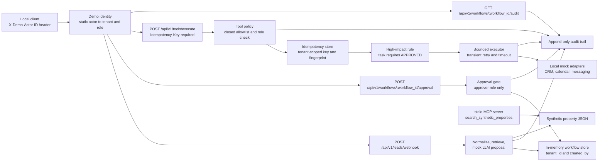

# ai-coo-real-estate-lab — Week 2

> This repository is a **controlled engineering demonstration** of a real-estate operations workflow. All leads and properties are synthetic. **No external system is ever called**: CRM, calendar, and messaging are represented by local, deterministic, in-memory mock adapters. Nothing is sent, booked, or written to any real system, and no real side effect is executed.

> Week 2 adds local mock CRM, calendar, and messaging tools, deterministic policy enforcement, demo tenant/role boundaries, idempotency, bounded mock-failure behavior, and a queryable audit trail. These are controlled adapters and local policy demonstrations; no external system, customer data, or real side effect is involved.

Week 1 built the core flow: a synthetic lead arrives over HTTP, is validated and normalized, matched against a synthetic property catalog, passed through a **mock** LLM-adapter boundary, and the resulting proposal waits behind a **human approval gate**. Week 2 puts explicit tool boundaries around that workflow: who may act, on which tenant's data, with which tool, how often, after which approval, and with what evidence.

> **Engineering principle:** explicit tool boundaries, strict schema validation, least privilege, tenant isolation, bounded failure behavior, human approval, idempotency, and evidence through auditability.

## What Week 2 demonstrates

- **Four local mock tools** behind one endpoint, `POST /api/v1/tools/execute`: CRM lead context, calendar availability, a messaging draft, and a mock CRM follow-up task.
- **Strict schemas.** Tool requests are a Pydantic discriminated union keyed by `tool_name`. Every model uses `extra="forbid"`, and numeric fields are strict and range-bounded. Results are typed per tool and always state `simulated: true` and `external_side_effect: false`.
- **A closed server-side allowlist** of tool names with a role policy. There is no dynamic dispatch, reflection, URL, path, or shell input.
- **Demo tenant and role boundaries.** A static `X-Demo-Actor-ID` maps to a tenant-bound principal. Cross-tenant access returns `404`; a missing capability returns `403`.
- **A human-approval boundary for a high-impact mock write.** `crm.create_follow_up_task` returns `409 approval_required` until an approver approves the workflow.
- **Tenant-scoped idempotency.** `Idempotency-Key` is required. An exact duplicate replays the stored result without running the adapter again. The same key with a different request returns `409 idempotency_key_reused`.
- **Bounded execution.** Only typed transient adapter errors are retried, up to `TOOL_MAX_ATTEMPTS`. Permanent, timeout, validation, and policy failures are never retried. A timed-out call never commits a mock record.
- **An append-only, queryable audit trail** per workflow, holding only allowlisted, non-sensitive fields.
- **A small read-only stdio MCP server** that exposes exactly one tool, `search_synthetic_properties`, over the synthetic catalog.
- 147 deterministic `pytest` tests, plus `ruff` lint/format checks.

Week 1 behavior is preserved. The only intentional contract changes are listed in [Compatibility notes](#compatibility-notes-week-1--week-2).

## What this repository explicitly does **not** demonstrate

- Real CRM, Gmail, GoHighLevel, calendar, SMTP, SMS, voice, or any external HTTP call. No API keys of any kind.
- Real LLM providers, RAG, embeddings, vector databases, or evaluation metrics (Week 3).
- Real authentication (OAuth, JWT, API keys, passwords), a production identity provider, or production authorization.
- PostgreSQL, Redis, queues, workers, durable sessions, checkpoints, DLQs, or crash recovery.
- Docker, CI/CD, cloud deployment, OpenTelemetry, dashboards, rate limiting, circuit breakers, or benchmarks (Week 4 covers packaging and CI).
- A network-exposed MCP endpoint, write-capable MCP tools, filesystem or shell tools.
- Any UI.

## Architecture



All stores are in process memory and are wiped on restart. That is deliberate for this milestone; durable storage is future work. See [`docs/architecture.md`](docs/architecture.md) for the full design.

## Demo identities and limitations

Every endpoint except `GET /health` requires `X-Demo-Actor-ID`. The value must be one of these four static, documented actors:

| Actor ID | Tenant | Role | Purpose |
| --- | --- | --- | --- |
| `tenant-a-operator` | `tenant-a` | `operator` | Creates workflows and invokes permitted tools. |
| `tenant-a-approver` | `tenant-a` | `approver` | Approves or rejects workflows. |
| `tenant-a-viewer` | `tenant-a` | `viewer` | Read-only workflow/audit access. |
| `tenant-b-operator` | `tenant-b` | `operator` | Tenant-isolation test identity. |

| Capability | `operator` | `approver` | `viewer` |
| --- | :---: | :---: | :---: |
| Create synthetic lead workflow | allowed | allowed | denied |
| Read own-tenant workflow and audit | allowed | allowed | allowed |
| Approve/reject own-tenant workflow | denied | allowed | denied |
| Invoke allowed mock tools | allowed | allowed | denied |

- **This is not production authentication.** The header is an unauthenticated, client-asserted label. Anyone who can reach the service can claim any of the four actors. It exists only to make tenant and role boundaries visible and testable. **Do not expose this service to the public internet.**
- The tenant always comes from the static mapping. A client-supplied tenant header is ignored.
- An absent or unknown actor returns `401 unknown_demo_actor`. A known actor without the capability returns `403 forbidden`. A workflow owned by another tenant returns `404 workflow_not_found`, identical to a missing one.
- The approver recorded on a workflow is always the resolved principal's `actor_id`. The approval body accepts only `decision` and an optional `comment`.

## Tool allowlist and high-impact rule

| Tool | Inputs (besides `tool_name`, `workflow_id`) | Behavior |
| --- | --- | --- |
| `crm.get_lead_context` | none | Read-only synthetic CRM context derived from the workflow. No contact details. |
| `calendar.find_availability` | `requested_date` (2024-01-01..2099-12-31), `duration_minutes` (15..120, multiple of 15) | Deterministic UTC slots on weekdays (09:00, 11:00, 14:00, 16:00 if they fit before 17:00), none on weekends. **Never books.** |
| `messaging.create_follow_up_draft` | `channel` (`"email"` only) | Stores an in-memory draft from the Week 1 proposal, marked `DRAFT`, `sent: false`. **Never sends.** The response returns metadata only, not the body. |
| `crm.create_follow_up_task` | `due_in_hours` (1..72) | **High-impact mock CRM write.** Allowed only when the workflow is `APPROVED`; otherwise `409 approval_required`. Creates one synthetic in-memory task. |

Clients can never supply recipient addresses, message text, CRM fields, URLs, file paths, or nested JSON. Unknown tool names and extra fields are rejected with `422` before any adapter runs.

Every result states `simulated: true` and `external_side_effect: false`. The workflow field `side_effect_executed` means a *real* external side effect, so it stays `false` before and after every mock tool call, including the mock task.

## Idempotency semantics

- `Idempotency-Key` is required on `POST /api/v1/tools/execute`. It must be 8–128 characters of `A–Z a–z 0–9 . _ : -`; otherwise the API returns `422`.
- Keys are **scoped per tenant**, so tenant A and tenant B can use the same key independently.
- The server computes a SHA-256 fingerprint over `tenant_id` plus the validated invocation (`tool_name`, `workflow_id`, and arguments). The invocation contains no lead PII.
- **First success:** `201 Created` with `idempotency_replayed: false`.
- **Exact replay** (same tenant, key, and fingerprint): `200 OK` with the same `execution_id`, `status: "REPLAYED"`, and `idempotency_replayed: true`. The adapter is not called again and no second mock record is created.
- **Changed request with a used key:** `409 idempotency_key_reused`.
- **Concurrent duplicate while the first is still running:** `409 idempotency_request_in_progress`.
- Only successful executions are stored for replay. A blocked (`approval_required`) or failed attempt releases its reservation, so the same key can be retried later, for example after approval.
- The check-and-reserve step runs under a single lock in the in-memory repository.

## Bounded execution and failure classification

| Category | Retried? | HTTP |
| --- | :---: | --- |
| `transient` | yes, up to `TOOL_MAX_ATTEMPTS` (default 2) | `503` if exhausted |
| `permanent` | no | `502` |
| `timeout` | no | `504` |
| `validation` (request or adapter output) | no | `422` (request) / `502` (adapter output) |
| `authorization` | no | `403` |
| `approval_required` | no | `409` |
| `idempotency_conflict` | no | `409` |
| `internal` (unexpected) | no | `500` with no exception text |

The timeout (`TOOL_TIMEOUT_SECONDS`, default `0.25`) is **cooperative**. The executor measures how long the adapter's side-effect-free `prepare` step took and only then calls `commit`. A slow attempt is discarded without storing a mock record. A running call is not preempted; a real I/O adapter would also need native client timeouts. Retries are immediate, with no backoff, because every adapter is an in-memory mock. Failure paths are exercised by deterministic test doubles; the API has no failure-injection field.

## Audit trail

`GET /api/v1/workflows/{workflow_id}/audit` returns the workflow's events in chronological order. It is tenant-protected (cross-tenant returns `404`), and there is no global all-tenants search.

Each event records only: `event_id`, `occurred_at` (UTC), `correlation_id`, `tenant_id`, `actor_id`, `workflow_id`, `event_type`, `outcome`, and optionally `tool_name`, `execution_id`, `idempotency_key_hash` (a tenant-salted SHA-256 prefix, never the raw key), `attempt`, and `error_category`.

Event types: `workflow_created`, `workflow_approved`, `workflow_rejected`, `workflow_decision_denied`, `tool_execution_started` (one per attempt), `tool_execution_succeeded`, `tool_execution_replayed`, `tool_execution_blocked_approval`, `tool_execution_denied`, `tool_execution_failed`, `idempotency_conflict`.

**Never recorded:** email, phone, lead message, message-draft body, raw tool arguments, prompt text, header values, exception text, or stack traces. The repository exposes only `append` and `list_for_workflow`, with no update or delete, and events are frozen models.

Structured application logs serve a different purpose and remain separate. Logs are operational, sanitized, and local. The audit trail is queryable evidence of each workflow and tool decision.

## MCP server (local stdio, read-only)

```bash
python -m app.mcp.server   # or: make mcp
```

- Local **stdio-only** process, with no network listener.
- Exactly **one** closed, read-only tool, `search_synthetic_properties`, with strict inputs `city`, `min_bedrooms`, `max_price`, and `max_results` (1..3). Extra fields and out-of-range values are rejected.
- Returns only fields from the public synthetic fixture `data/properties.synthetic.json`, or an empty list when nothing matches.
- No writes, network calls, shell, filesystem tools, CRM/calendar/messaging access, or approvals.
- Logs go to **stderr only**, so stdout carries nothing but MCP protocol messages.
- `MCP_DEMO_ACTOR_ID` must name a known demo actor and labels the log lines. **It is not authentication or authorization**: whoever can start the process can use the tool.

See [`docs/mcp.md`](docs/mcp.md) for the schema and client configuration.

## Prerequisites

- Python 3.11 or newer.
- No API key is needed; everything runs locally with mocks.
- The `curl` walkthrough uses a POSIX shell (macOS/Linux, Git Bash, or WSL on Windows).

## Quick start (clean clone)

```bash
git clone <your-fork-url>
cd ai-coo-real-estate-lab
python -m venv .venv
# on Windows:  .venv\Scripts\Activate.ps1
# on macOS/Linux: source .venv/bin/activate
python -m pip install -e ".[dev]"
make test
make lint
make run
```

## Environment variables

Copy `.env.example` to `.env` if you want explicit values. The defaults are already safe, and none of them are secrets.

```dotenv
APP_ENV=development
LOG_LEVEL=INFO
AGENT_PROVIDER=mock
TOOL_MAX_ATTEMPTS=2          # validated range 1..5
TOOL_TIMEOUT_SECONDS=0.25    # validated range 0 < t <= 5.0
MCP_DEMO_ACTOR_ID=tenant-a-operator
```

## `curl` walkthrough

Start the service with `make run`, then run these in a second terminal. The commands print the HTTP status after each body.

```bash
BASE=http://127.0.0.1:8000
JSON='Content-Type: application/json'
OPERATOR='X-Demo-Actor-ID: tenant-a-operator'
APPROVER='X-Demo-Actor-ID: tenant-a-approver'
VIEWER='X-Demo-Actor-ID: tenant-a-viewer'
TENANT_B='X-Demo-Actor-ID: tenant-b-operator'
SHOW='\nHTTP %{http_code}\n'

curl -s $BASE/health
```

**1. `tenant-a-operator` creates a synthetic lead workflow.**

```bash
WORKFLOW_ID=$(curl -s -X POST $BASE/api/v1/leads/webhook -H "$JSON" -H "$OPERATOR" \
  -H 'X-Correlation-ID: demo-week2-001' \
  -d '{
    "lead_id": "lead-demo-001",
    "first_name": "Avery",
    "last_name": "Stone",
    "email": "avery.stone@example.com",
    "phone": "+1 (555) 010-0101",
    "preferred_city": "Austin",
    "budget_max": 650000,
    "min_bedrooms": 3,
    "message": "Looking for a family home near parks. I can tour this weekend."
  }' | python -c "import json,sys; print(json.load(sys.stdin)['workflow']['workflow_id'])")
echo "$WORKFLOW_ID"
```

**2. An allowed draft action succeeds** (`201`, `status: SUCCEEDED`, `sent: false`).

```bash
curl -s -w "$SHOW" -X POST $BASE/api/v1/tools/execute -H "$JSON" -H "$OPERATOR" \
  -H 'Idempotency-Key: demo-draft-0001' \
  -d '{"tool_name":"messaging.create_follow_up_draft","workflow_id":"'"$WORKFLOW_ID"'","channel":"email"}'
```

**3. `tenant-a-viewer` attempts a tool action** and gets `403`.

```bash
curl -s -w "$SHOW" -X POST $BASE/api/v1/tools/execute -H "$JSON" -H "$VIEWER" \
  -H 'Idempotency-Key: demo-viewer-0001' \
  -d '{"tool_name":"calendar.find_availability","workflow_id":"'"$WORKFLOW_ID"'","requested_date":"2030-03-04","duration_minutes":60}'
```

**4. The high-impact mock task on a pending workflow** gets `409 approval_required`.

```bash
curl -s -w "$SHOW" -X POST $BASE/api/v1/tools/execute -H "$JSON" -H "$OPERATOR" \
  -H 'Idempotency-Key: demo-task-0001' \
  -d '{"tool_name":"crm.create_follow_up_task","workflow_id":"'"$WORKFLOW_ID"'","due_in_hours":24}'
```

**5. `tenant-a-approver` approves the workflow.** `approval.approved_by` is `tenant-a-approver`, and `side_effect_executed` stays `false`.

```bash
curl -s -w "$SHOW" -X POST $BASE/api/v1/workflows/$WORKFLOW_ID/approval -H "$JSON" -H "$APPROVER" \
  -d '{"decision":"approve","comment":"Reviewed in local demo"}'
```

**6. `tenant-a-operator` executes the same mock task after approval.** The response is `201` with `simulated: true` and `external_side_effect: false`. The key from step 4 is reusable because blocked attempts are not stored.

```bash
curl -s -w "$SHOW" -X POST $BASE/api/v1/tools/execute -H "$JSON" -H "$OPERATOR" \
  -H 'Idempotency-Key: demo-task-0001' \
  -d '{"tool_name":"crm.create_follow_up_task","workflow_id":"'"$WORKFLOW_ID"'","due_in_hours":24}'
```

**7. An identical repeat replays** (`200`, same `execution_id`, `status: REPLAYED`, `idempotency_replayed: true`). No second mock task is created.

```bash
curl -s -w "$SHOW" -X POST $BASE/api/v1/tools/execute -H "$JSON" -H "$OPERATOR" \
  -H 'Idempotency-Key: demo-task-0001' \
  -d '{"tool_name":"crm.create_follow_up_task","workflow_id":"'"$WORKFLOW_ID"'","due_in_hours":24}'
```

**8. The same key with changed arguments** gets `409 idempotency_key_reused`.

```bash
curl -s -w "$SHOW" -X POST $BASE/api/v1/tools/execute -H "$JSON" -H "$OPERATOR" \
  -H 'Idempotency-Key: demo-task-0001' \
  -d '{"tool_name":"crm.create_follow_up_task","workflow_id":"'"$WORKFLOW_ID"'","due_in_hours":48}'
```

**9. `tenant-b-operator` cannot see tenant A's workflow or audit trail** (`404` twice).

```bash
curl -s -w "$SHOW" $BASE/api/v1/workflows/$WORKFLOW_ID -H "$TENANT_B"
curl -s -w "$SHOW" $BASE/api/v1/workflows/$WORKFLOW_ID/audit -H "$TENANT_B"
```

**10. `tenant-a-operator` reads the audit trail.**

```bash
curl -s $BASE/api/v1/workflows/$WORKFLOW_ID/audit -H "$OPERATOR" | python -m json.tool
```

Expected event sequence: `workflow_created`, `tool_execution_started`, `tool_execution_succeeded` (draft), `tool_execution_denied` (viewer), `tool_execution_blocked_approval`, `workflow_approved`, `tool_execution_started`, `tool_execution_succeeded` (task), `tool_execution_replayed`, `idempotency_conflict`.

Finally, confirm that no real side effect was recorded:

```bash
curl -s $BASE/api/v1/workflows/$WORKFLOW_ID -H "$OPERATOR" | python -m json.tool | grep side_effect_executed
# "side_effect_executed": false
```

## Compatibility notes (Week 1 → Week 2)

- All endpoints except `/health` now require `X-Demo-Actor-ID`.
- `POST /api/v1/workflows/{workflow_id}/approval` accepts only `decision` and an optional `comment` (max 500 characters). The former `approved_by` field is rejected with `422`; the approver now comes from the principal, and only the `approver` role may decide.
- Workflows and summaries now include `tenant_id` and `created_by`.
- `422` responses use the project's error envelope, `{"detail": {"correlation_id", "error", "detail", "error_category", "fields": [{"loc", "msg", "type"}]}}`, and no longer echo rejected input values.
- Handled errors include the `X-Correlation-ID` response header.

## Testing and linting

```bash
make install   # installs the project with dev extras
make test      # pytest
make lint      # ruff check + ruff format --check
make format    # apply ruff fixes and formatting
```

On Windows without `make`, the underlying commands are:

```bash
python -m pip install -e ".[dev]"
python -m pytest
python -m ruff check .
python -m ruff format --check .
```

## Technical decisions, trade-offs, and known limits

- **FastAPI + Pydantic v2** at every boundary. The tool request is a discriminated union, so an unknown tool cannot reach a code path.
- **Policy in one module** (`app/security/tool_policy.py`), enforced in the services rather than the routes, so a new route cannot skip it.
- **Prepare/commit adapters** make the timeout guarantee structural: nothing is stored unless the attempt finished within budget.
- **The in-memory workflow, idempotency, audit, and mock-record stores** keep the demo hermetic and reproducible. All of them are lost on restart, there is no cross-process locking, and they are unsuitable for more than one worker process.
- **Demo identity, not auth.** The `X-Demo-Actor-ID` mapping makes boundaries testable without pretending to be secure.
- **Sanitized logs and audit records** never contain email, phone, message text, draft bodies, or raw tool arguments.

## Security and scope boundaries

- **All data is synthetic.** The catalog is labeled `is_synthetic: true`; test leads use `example.com` and fictional `555` numbers.
- **No real authentication.** The service is local/demo-only. Do not expose it to the public internet.
- **No external integration or real side effect exists.** Mock drafts are never sent, mock availability never books, and mock tasks exist only in process memory.
- **Not production security.** The tenant/role checks, allowlist, and audit trail are controlled demonstrations of the boundaries, not a certified or hardened implementation.
- **Do not use with customer data.**

## Roadmap — future work only

- **Week 3:** RAG ingestion, embeddings, retrieval evaluation, and a real LLM adapter that is opt-in, disabled by default, and never required by tests.
- **Week 4:** Docker packaging, CI, broader portfolio polish, and the 3–5 minute demo video following [`docs/demo-plan.md`](docs/demo-plan.md).
- **Later:** durable PostgreSQL storage for workflows, idempotency, and audit; real authentication and an identity provider; retry backoff; a DLQ; OpenTelemetry; rate limiting.

## License

MIT — portfolio sample, not a commercial product.
