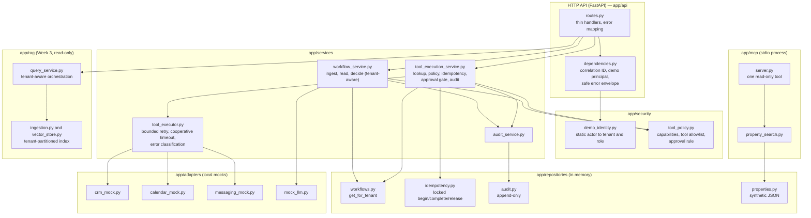
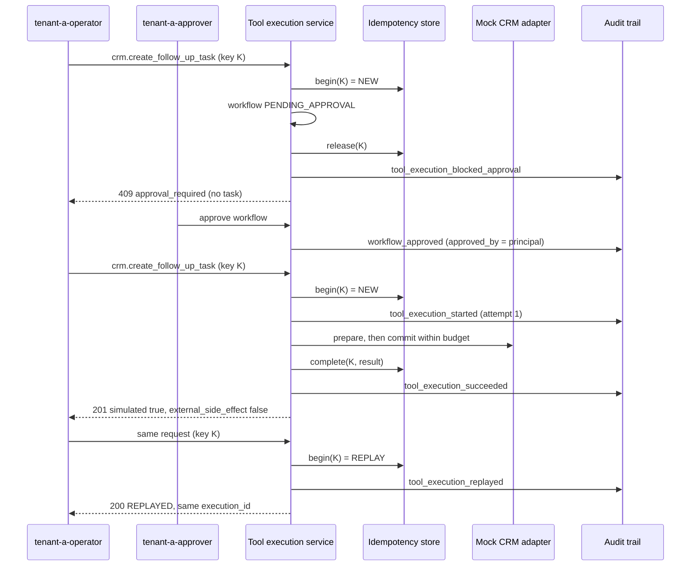
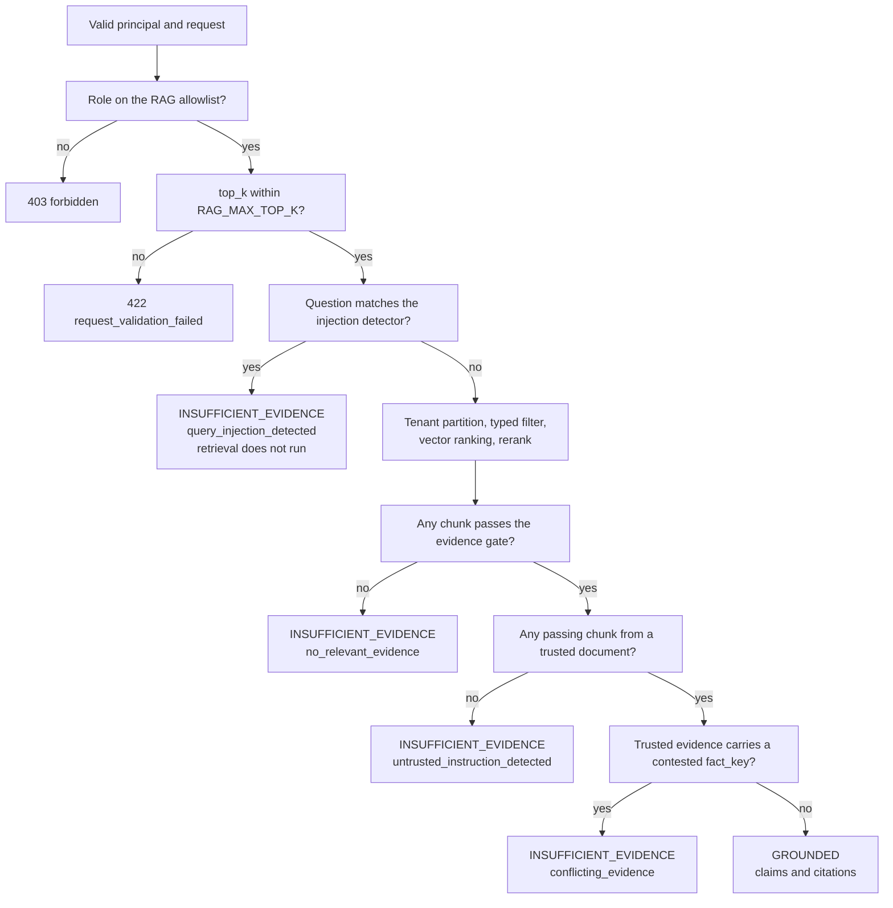
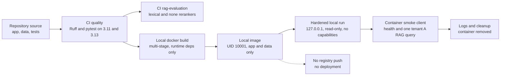

# Architecture — ai-coo-real-estate-lab Week 4

This document explains the components, boundaries, and data flow after Week 4. It is intentionally explicit about what is in scope and what is deferred. Everything described here runs in one local process, against synthetic data and in-memory mock adapters, whether it is started with `make run` or in the local container.

Week 3 adds a contained, read-only RAG package (`app/rag/`). The Week 1 and Week 2 components below are intact and unchanged; the RAG design starts at [Week 3: secure RAG](#week-3-secure-rag). Week 4 (version `0.4.0`) adds no runtime component; it packages and verifies the same application, as described in [Delivery and verification boundary](#delivery-and-verification-boundary).

## Components and layer boundaries



The rules are:

- Routes stay thin. They resolve dependencies, call one service method, and map typed exceptions to HTTP.
- Policy lives in `app/security/tool_policy.py` and is enforced **inside the services**, so a new route cannot bypass it.
- Services receive repositories and adapters through constructor injection (`app/main.py`), and none of them read `app.state`.
- Adapters receive a `ToolContext`, a frozen, safe projection of the workflow. They never see the workflow repository and never receive contact details. Lead email, phone, and message are not persisted in the workflow at all, so no tool can leak them.

## Identity-to-tenant binding

1. Every endpoint except `GET /health` depends on `demo_principal`, which reads `X-Demo-Actor-ID`.
2. `resolve_demo_principal` looks the value up in a frozen, static table of exactly four actors. A missing or unknown value returns `401 unknown_demo_actor`.
3. The resulting `DemoPrincipal(actor_id, tenant_id, role)` is the only source of tenant identity. No client-supplied tenant field or header is read.
4. On creation, a workflow binds `tenant_id` and `created_by` from the principal.
5. All workflow access goes through `WorkflowRepository.get_for_tenant(tenant_id, workflow_id)`. A workflow owned by another tenant is indistinguishable from a missing one, and both return `404 workflow_not_found` for read, approval, tool invocation, and audit query.

**This is not authentication.** The header is unauthenticated and client-asserted. Its only purpose is to make the authorization boundary visible and testable in a local demo.

## Role and tool-policy matrix

| Capability | `operator` | `approver` | `viewer` |
| --- | :---: | :---: | :---: |
| `create_workflow` | ✓ | ✓ | — |
| `read_workflow` (workflow and audit) | ✓ | ✓ | ✓ |
| `decide_workflow` | — | ✓ | — |
| `invoke_tools` | ✓ | ✓ | — |

| Tool (`ToolName` enum) | Impact | Allowed roles | Requires `APPROVED` workflow |
| --- | --- | --- | :---: |
| `crm.get_lead_context` | read | operator, approver | no |
| `calendar.find_availability` | read | operator, approver | no |
| `messaging.create_follow_up_draft` | draft | operator, approver | no |
| `crm.create_follow_up_task` | mock write | operator, approver | **yes** |

Checks run in this order. Tenant lookup comes first (`404`), then capability (`403`), so cross-tenant callers never learn that a workflow exists and same-tenant callers get an honest `403`. Denied tool calls and denied approval attempts are audited. A test asserts that `TOOL_ALLOWLIST` covers exactly the members of `ToolName`, so the two cannot drift apart.

## Typed tool boundary

`POST /api/v1/tools/execute` accepts a `ToolInvocationRequest`, a root model over a Pydantic **discriminated union** keyed by `tool_name`:

| Model | Fields |
| --- | --- |
| `CrmGetLeadContextInvocation` | `tool_name`, `workflow_id` |
| `CalendarFindAvailabilityInvocation` | `+ requested_date` (2024-01-01..2099-12-31), `duration_minutes` (strict int, 15..120, multiple of 15) |
| `MessagingCreateFollowUpDraftInvocation` | `+ channel` (`Literal["email"]`) |
| `CrmCreateFollowUpTaskInvocation` | `+ due_in_hours` (strict int, 1..72) |

Every model uses `extra="forbid"` and `frozen=True`. Strict integers reject strings, booleans, and floats. An unknown `tool_name` fails discriminator validation (`422`) before any service code runs. Dispatch is a closed `match` over the four model types, ending in `assert_never`, with no lookup by string, import, or reflection.

Results are `ToolExecutionResult` with `simulated: Literal[True]`, `external_side_effect: Literal[False]`, `attempts`, `idempotency_replayed`, `status` (`SUCCEEDED` or `REPLAYED`), and a per-tool payload, which is itself a discriminated union on `kind`. The messaging result returns draft metadata only (`draft_id`, `status: DRAFT`, `sent: false`, `body_length`), never the body.

## Idempotency algorithm

```text
key_scope   = (tenant_id, Idempotency-Key)
fingerprint = sha256(canonical_json({tenant_id, invocation.model_dump()}))

under lock:
  no record                       -> reserve (in progress), proceed
  record.fingerprint != current   -> 409 idempotency_key_reused
  record in progress              -> 409 idempotency_request_in_progress
  record completed                -> replay stored result (200, REPLAYED)

after the attempt:
  success                         -> complete(record, result)
  approval block / failure        -> release(record)   # key may be retried
```

- The key header is validated at the HTTP boundary: 8–128 characters, `[A-Za-z0-9._:-]`.
- The fingerprint covers tenant, tool, workflow, and the validated arguments. It contains no lead PII.
- Replay returns the original `execution_id` and payload and **does not call the adapter**.
- Only successful results are stored. Releasing after a block or failure lets an operator retry with the same key, for example after approval. A consequence is that a different request could then claim that key; this is documented as acceptable for the demo.
- The audit trail records the key only as `sha256:<16 hex>` of `tenant_id:key`.

## High-impact approval sequence



`Workflow.side_effect_executed` means a *real* external side effect. It remains `false` throughout, and the mock task lives only in the CRM mock's memory.

The approval decision itself is serialized by a lock in `WorkflowService.decide`, so the read-check-save is atomic and exactly one decision wins even under concurrent requests.

## Retry, timeout, and error classification

`BoundedToolExecutor` (in `app/services/tool_executor.py`) runs each attempt as **prepare**, which computes the result without changing state, followed by an optional **commit**, which stores the synthetic record.

| Adapter outcome | Category | Retried | HTTP |
| --- | --- | :---: | --- |
| `TransientToolError` | `transient` | yes, until `TOOL_MAX_ATTEMPTS` | `503` when exhausted |
| `PermanentToolError` | `permanent` | no | `502` |
| `ToolTimeoutError`, or prepare exceeded `TOOL_TIMEOUT_SECONDS` | `timeout` | no | `504` |
| `pydantic.ValidationError` from adapter output | `validation` | no | `502` |
| any other exception | `internal` | no | `500` generic body |

Policy outcomes (`authorization` → `403`, `approval_required` → `409`, `idempotency_conflict` → `409`) and request validation (`422`) are decided before the executor runs and are never retried.

Configuration is validated twice, by `AppSettings` and by `ToolExecutionPolicy`: `TOOL_MAX_ATTEMPTS` must be 1..5 and `TOOL_TIMEOUT_SECONDS` must be in (0, 5.0].

Limitations, stated plainly:

- The timeout is **cooperative**. Elapsed time is measured around `prepare` with a monotonic clock, which is injectable for tests. A slow call is not interrupted, but its result is discarded and `commit` is never called, so a timeout cannot leave a mock record behind. Real network adapters would also need native client timeouts.
- Retries are immediate, with no backoff or jitter, because all adapters are in-memory mocks.
- No circuit breaker, DLQ, or background retry exists.
- Every audit event records the attempt number, so retries are visible as multiple `tool_execution_started` events.

## Audit-field allowlist and redaction policy

`AuditEvent` is a frozen, `extra="forbid"` model whose fields form the allowlist: `event_id`, `occurred_at` (UTC), `correlation_id`, `tenant_id`, `actor_id`, `workflow_id`, `event_type`, `outcome`, `tool_name?`, `execution_id?`, `idempotency_key_hash?`, `attempt?`, `error_category?`.

The audit trail never contains email, phone, lead message, draft body, raw tool arguments, prompt text, header values, exception text, or stack traces. Tests assert this for both the audit API and the captured application logs.

`InMemoryAuditRepository` exposes only `append` and `list_for_workflow(tenant_id, workflow_id)`. Events are returned in append order, which is chronological, and there is no all-tenants query.

Logs and audit records have separate roles. Logs are operational JSON on stdout (stderr for MCP), and they carry correlation ID, tenant, actor, workflow, tool, attempt, status, and error category. Audit records are the queryable evidence behind workflow and tool decisions.

## Why everything is in memory and local

- **Hermetic and reproducible.** `pytest` and the curl walkthrough need no services, network, or secrets.
- **Honest scope.** This milestone demonstrates *boundaries*. Durability, cross-process locking, and multi-worker deployment are separate problems, and they are listed under [Scope beyond Week 4](#scope-beyond-week-4).
- **Consequences.** A restart wipes workflows, idempotency records, audit events, and mock records. The idempotency and decision locks are per-process only, so this service is unsuitable for more than one worker.

## Week 1 pipeline (unchanged)

1. The webhook validates and normalizes the lead: whitespace collapse, lowercase email, phone digits in `+[country][digits]` form, range checks, and at least one contact method.
2. Deterministic synthetic retrieval scores each property (`city: 5`, `budget: 2`, `bedrooms: 2`, `near budget: 1`), sorts by `(-score, property_id)`, and keeps the top 3.
3. The `MockLeadProposalAgent` produces a typed proposal whose draft is marked `[PROPOSAL FOR REVIEW — NOT SENT]`.
4. The service checks that recommended IDs are a subset of the retrieved set and that `requires_human_approval` is true.
5. The workflow is saved as `PENDING_APPROVAL` with `side_effect_executed: false`. Exactly one approve or reject decision is allowed, and a second one returns `409`.

## Week 3: secure RAG

A read-only question-answering path over a small synthetic corpus. It uses no model, no external service, and no network. The RAG service never calls a tool, never reads or writes a workflow, and is not exposed through the MCP server.

### Modules

| Module | Responsibility |
| --- | --- |
| `app/rag/config.py` | `RagSettings` (bounded env settings) and the validated `RagConfig`. `AppSettings` inherits `RagSettings`. |
| `app/rag/text.py` | Whitespace normalization, tokenizer, stopword list. Shared by embedding, reranking, and grounding. |
| `app/rag/corpus.py` | Loads and strictly validates the fixture. Errors name fields, never content. |
| `app/rag/redaction.py` | Email and telephone redaction. |
| `app/rag/chunking.py` | Token windows, stable chunk IDs, content hashes. |
| `app/rag/embeddings.py` | `DeterministicHashEmbeddingProvider` and cosine similarity. |
| `app/rag/vector_store.py` | In-memory index partitioned by tenant. |
| `app/rag/retrieval.py` | Embeds the question and returns a bounded pool. |
| `app/rag/reranking.py` | `none` and `lexical` rerankers. |
| `app/rag/injection.py` | Injection-like phrase detector. |
| `app/rag/grounding.py` | Evidence gate, trust and conflict checks, extractive composer. |
| `app/rag/ingestion.py` | The startup pipeline that builds the index. |
| `app/rag/query_service.py` | Orchestration, safe logging, RAG audit events. |
| `app/rag/evaluation.py`, `app/rag/index_cli.py` | Local CLIs. |
| `app/security/rag_policy.py` | Role allowlist for the RAG endpoints. |
| `app/repositories/rag_audit.py` | Append-only RAG audit store. |

`app/main.py` builds the RAG service explicitly (`build_rag_query_service`) and stores it on `app.state`; the two routes in `app/api/routes.py` each make one service call.

### Ingestion pipeline

```mermaid
flowchart LR
    Fixture["data/rag/synthetic_documents.v1.json"] --> Validate["Strict validation<br/>is_synthetic must be true"]
    Validate --> Redact["Redact title and content<br/>email and phone markers"]
    Redact --> Normalize["Normalize whitespace"]
    Normalize --> Quarantine["Injection screen<br/>flag the whole document"]
    Quarantine --> Chunk["Token windows<br/>80 tokens, 20 overlap"]
    Chunk --> Embed["Hashed lexical embedding<br/>128 signed buckets"]
    Embed --> Index["In-memory index<br/>one partition per tenant"]
```



1. **Validate.** `SyntheticCorpus` and `CorpusDocument` use `extra="forbid"`. `is_synthetic` is `Literal[True]`. Document IDs must be unique, and `fact_key` / `fact_value` must come as a pair. Any failure raises `CorpusValidationError` and the app does not start. The message lists field locations and error types only.
2. **Redact.** Before anything else touches the text. Email addresses become `[REDACTED_EMAIL]`; North American-style telephone numbers, which covers the fixture's fictional `555` value, become `[REDACTED_PHONE]`. Titles are redacted too, because they are returned in citations.
3. **Normalize.** Whitespace runs collapse to single spaces.
4. **Screen.** If the redacted document matches the injection detector, every chunk of it is flagged `untrusted_instruction`.
5. **Chunk.** Windows of `RAG_CHUNK_SIZE_TOKENS` whitespace tokens with `RAG_CHUNK_OVERLAP_TOKENS` overlap. Chunk ID is `<source_document_id>#chunk-<NNN>`. Each chunk keeps tenant, title, document type, city, property ID, chunk index, a `sha256:` content hash, the number of redaction markers it contains, the document's redaction count, the fact tags, and the untrusted flag. An empty window is never produced.
6. **Embed and index.** Content tokens are embedded and the entry is added to its tenant's partition. Duplicate chunk IDs and vectors of the wrong size are rejected.

There is no HTTP ingestion path. `python -m app.rag.index_cli` runs the same pipeline and prints counts plus an `index_fingerprint`, a digest of every chunk ID and content hash that is identical on every run.

### Local hashed lexical embedding: what it is and is not

`DeterministicHashEmbeddingProvider` lowercases the text, keeps alphanumeric tokens, drops a short stopword list, folds simple plurals, and adds each token's count to one of `RAG_EMBEDDING_DIMENSIONS` buckets chosen by `hashlib.sha256`, with a hash-derived sign. The vector is L2-normalized, so cosine similarity is a dot product.

- It uses `hashlib`, never Python's `hash()`, which is randomized per process. A test builds the index in two subprocesses with different `PYTHONHASHSEED` values and compares the results.
- It is **lexical**. Two texts are similar only when they share tokens. It has no knowledge of synonyms or meaning and is not a pretrained semantic model.
- It **collides**. With 128 buckets and roughly 50 content tokens per chunk, unrelated tokens often share a bucket. A chunk can score above the vector threshold while sharing no term with the question; the evaluation's no-evidence case contains one. This is the reason for the second evidence check described below.

### Tenant-before-ranking and filter-before-ranking

`InMemoryVectorStore.search(tenant_id, query_vector, filters, limit)` does three things in a fixed order:

1. select the tenant's partition (a dictionary lookup, so other tenants' entries are not iterated);
2. keep entries that match the typed filter (`city` case-insensitive, `document_type`, `property_id`);
3. compute similarity for the survivors, sort by score descending then `chunk_id`, and keep the first 20.

Steps 1 and 2 happen before any score exists. Tests inject a recording similarity function and assert that the set of scored chunks equals the tenant- and filter-constrained set.

The store's public surface is `add`, `search`, `get`, `stats`, and `contested_fact_keys`. Every read takes a `tenant_id`. There is no method that lists or searches across tenants, so a caller cannot forget the tenant filter.

### Reranking

`RAG_RERANKER` selects the reranker at startup. A request cannot choose it.

- **`none`** keeps the vector order and attaches no rerank score.
- **`lexical`** scores each candidate as *term coverage* (the fraction of the question's distinct content terms present in the chunk) plus 0.1 for each adjacent pair of question terms that is also adjacent in the chunk, capped at 0.3.

Both order by score descending, then `chunk_id` ascending, so ties are stable. A reranker receives the bounded pool and returns a permutation of it; it has no access to the store and cannot add a chunk.

### Grounding and citation policy

The composer in `app/rag/grounding.py` is deterministic and extractive. It is not an LLM.

- **Evidence gate.** A chunk is evidence only if `retrieval_score >= RAG_MIN_EVIDENCE_SCORE` (default 0.15) **and** term coverage `>= RAG_MIN_QUERY_TERM_COVERAGE` (default 0.7). The gate does not depend on the reranker setting.
- **Selection.** Evidence is the first `top_k` trusted chunks that pass the gate, in reranked order.
- **Claims.** For each evidence chunk, the sentence that shares the most question terms is copied verbatim (at most 240 characters). Identical sentences from overlapping chunks merge into one claim that cites both chunks.
- **Citations.** One per evidence chunk: `source_document_id`, `chunk_id`, `title`, `document_type`, `chunk_index`, `excerpt`, `retrieval_score`, `rerank_score`. The excerpt starts at the claim sentence and is cut at a word boundary within 280 characters.
- **Answer.** A fixed prefix followed by each claim in quotes with `[n]` markers that index the citation list.
- **Model-level invariant.** `RagQueryResponse` rejects a grounded response without claims or citations, a claim that references a chunk not in the citations, and an insufficient-evidence response that carries any evidence or lacks a reason.

The composer does not infer, merge, summarize, or recommend. It may quote a sentence that is related to the question without being the best answer; that is a documented limit of lexical matching, not a fabricated claim.

### Decision flow



- **Trust and conflict checks look at the whole pool**, not only the first `top_k`. An untrusted chunk that ranks first is skipped rather than displacing trusted evidence, and a small `top_k` cannot hide a contradiction.
- **Contested fact keys are computed per tenant, over the whole partition.** A `fact_key` with more than one `fact_value` among the tenant's trusted documents is contested. Because this ignores the request's filter, filtering to one side of a contradiction still returns `conflicting_evidence`. Untrusted documents are excluded from the computation, so an injected note cannot create a conflict to suppress an answer.
- **Contradiction handling is a controlled demonstration.** It depends on explicit fixture tags and is tenant-scoped: tenant B, which has a single value for the same key, is answered. It is not a general natural-language contradiction engine.
- **Incomplete evidence** has no separate reason. A document that mentions the subject but not the requested facts fails the coverage check and yields `no_relevant_evidence`.
- **The injection detector is a short phrase list** (`app/rag/injection.py`) applied to the question and, at ingestion, to documents. It is easy to evade and is not a prompt-injection defense. What it demonstrates is where the control sits: untrusted text is screened before it can influence retrieval or reach an answer, and it is never echoed.
- Every insufficient-evidence result is a `200` with the same fixed message, zero claims, and zero citations.

### RAG log and audit allowlists

One log line per query, event `rag_query_completed`, with exactly these fields besides the formatter's standard ones: `correlation_id`, `tenant_id`, `actor_id`, `query_id`, `answer_status`, `insufficient_evidence_reason`, `filtered_candidate_count`, `returned_citation_count`, `reranker`, `latency_ms`.

`RagAuditEvent` is a frozen, `extra="forbid"` model whose fields are the allowlist: `event_id`, `occurred_at` (UTC), `correlation_id`, `tenant_id`, `actor_id`, `query_id`, `event_type`, `answer_status?`, `insufficient_evidence_reason?`.

| Event | Recorded when |
| --- | --- |
| `rag_query_received` | The request passed the role and `top_k` checks. |
| `rag_query_tenant_scoped` | Tenant-bound retrieval is about to run. Absent for an injection-like question. |
| `rag_query_grounded` | A grounded answer was produced. |
| `rag_query_insufficient_evidence` | Any of the four insufficient-evidence reasons. |

Neither destination ever holds question text, document content, excerpts, answer text, filter values, vectors, redacted values, the injection phrase, or a traceback. Tests assert this against captured log lines and the stored events.

Why a second audit model: the Week 2 `AuditEvent` requires a `workflow_id`, and a test pins its field set as a closed allowlist. A RAG query has no workflow. Making `workflow_id` optional would loosen the Week 2 schema, so Week 3 adds `RagAuditEvent` and `InMemoryRagAuditRepository` (`append`, `list_for_tenant`) and leaves the Week 2 model untouched. RAG audit events are held in memory and are not exposed over HTTP in this milestone.

### Index lifecycle and limits

- The index is built once, in `build_app`, from the committed fixture. It is immutable afterwards: no endpoint adds, updates, or deletes a document.
- Everything is in process memory. A restart rebuilds the same index from the fixture and discards RAG audit events.
- One process only. There is no persistence, replication, or cross-process coordination.
- Search is a linear scan of the tenant partition with pure-Python arithmetic. That is adequate for 15 chunks and is not a design for scale.
- `RAG_CORPUS_PATH` exists for tests and for the committed fixture. Do not point it at real documents.

## Delivery and verification boundary

Week 4 adds delivery artifacts at the repository root (`Dockerfile`, `.dockerignore`, `compose.yaml`, `scripts/container_smoke.py`, `.github/workflows/ci.yml`). None of them live in, or change, the domain, RAG, tool, or policy code.



- **CI is verification only.** It runs on pushes to `main`, pull requests, and manual dispatch with a read-only token and no secrets. The image it builds exists only on the runner and is discarded with it.
- **The runtime is unchanged.** The container runs the same `app.main:app` as `make run`, without `--reload`: one Uvicorn process, in-memory stores, the committed synthetic fixtures, static demo identities, and no outbound calls. A container restart resets all state exactly like a process restart.
- **Source, not a wheel.** The image installs only the dependency wheels and copies `app/` and `data/` to `/app`, because the fixture paths are resolved relative to the `app/` package.
- **The local boundary is the network binding.** Compose and the documented `docker run` publish to `127.0.0.1` only. The demo identity header is not authentication, so the binding is what keeps the service private.

Operational details and limits are in [`container.md`](container.md).

## Scope beyond Week 4

- **Week 4 (this milestone):** local Docker packaging, Compose, CI verification, and release documentation. The demo recording is a human step that follows [`recording-guide.md`](recording-guide.md).
- **Separate future decisions, not commitments:** PostgreSQL-backed workflows, idempotency, and audit with optimistic locking; a durable vector index; real authentication and an identity provider; an opt-in real embedding model and LLM adapter (disabled by default, never used in tests) measured on the same versioned evaluation dataset; a queryable RAG audit endpoint; backoff, DLQ, and circuit breakers; OpenTelemetry; rate limiting; deployment and production hardening.
