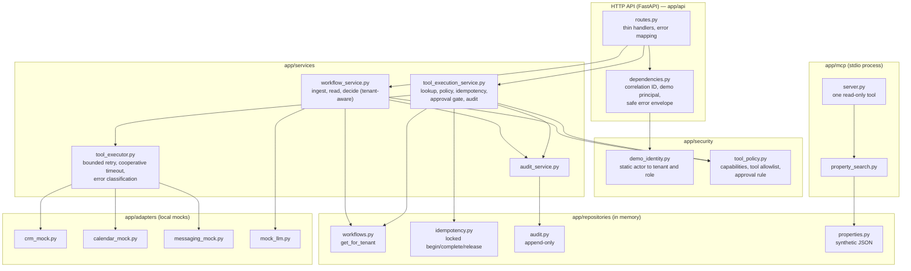
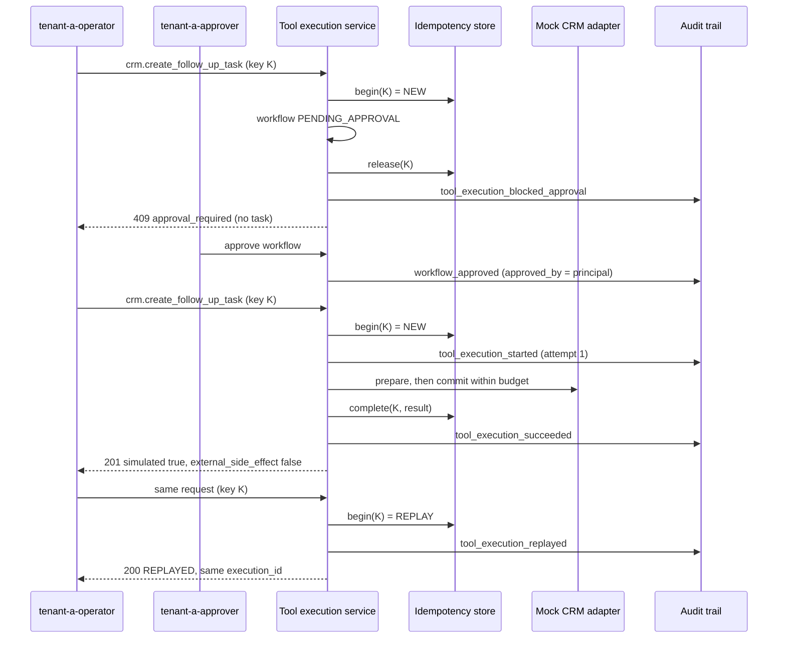

# Architecture — ai-coo-real-estate-lab Week 2

This document explains the components, boundaries, and data flow after Week 2. It is intentionally explicit about what is in scope and what is deferred. Everything described here runs in one local process, against synthetic data and in-memory mock adapters.

## Components and layer boundaries



The rules are:

- Routes stay thin. They resolve dependencies, call one service method, and map typed exceptions to HTTP.
- Policy lives in `app/security/tool_policy.py` and is enforced **inside the services**, so a new route cannot bypass it.
- Services receive repositories and adapters through constructor injection (`app/main.py`), and none of them read `app.state`.
- Adapters receive a `ToolContext`, a frozen, safe projection of the workflow. They never see the workflow repository and never receive contact details. Lead email, phone, and message are not persisted in the workflow at all, so no tool can leak them.

## Identity-to-tenant binding

1. Every endpoint except `GET /health` depends on `demo_principal`, which reads `X-Demo-Actor-ID`.
2. `resolve_demo_principal` looks the value up in a frozen, static table of exactly four actors. A missing or unknown value returns `401 unknown_demo_actor`.
3. The resulting `DemoPrincipal(actor_id, tenant_id, role)` is the only source of tenant identity. No client-supplied tenant field or header is read.
4. On creation, a workflow binds `tenant_id` and `created_by` from the principal.
5. All workflow access goes through `WorkflowRepository.get_for_tenant(tenant_id, workflow_id)`. A workflow owned by another tenant is indistinguishable from a missing one, and both return `404 workflow_not_found` for read, approval, tool invocation, and audit query.

**This is not authentication.** The header is unauthenticated and client-asserted. Its only purpose is to make the authorization boundary visible and testable in a local demo.

## Role and tool-policy matrix

| Capability | `operator` | `approver` | `viewer` |
| --- | :---: | :---: | :---: |
| `create_workflow` | ✓ | ✓ | — |
| `read_workflow` (workflow and audit) | ✓ | ✓ | ✓ |
| `decide_workflow` | — | ✓ | — |
| `invoke_tools` | ✓ | ✓ | — |

| Tool (`ToolName` enum) | Impact | Allowed roles | Requires `APPROVED` workflow |
| --- | --- | --- | :---: |
| `crm.get_lead_context` | read | operator, approver | no |
| `calendar.find_availability` | read | operator, approver | no |
| `messaging.create_follow_up_draft` | draft | operator, approver | no |
| `crm.create_follow_up_task` | mock write | operator, approver | **yes** |

Checks run in this order. Tenant lookup comes first (`404`), then capability (`403`), so cross-tenant callers never learn that a workflow exists and same-tenant callers get an honest `403`. Denied tool calls and denied approval attempts are audited. A test asserts that `TOOL_ALLOWLIST` covers exactly the members of `ToolName`, so the two cannot drift apart.

## Typed tool boundary

`POST /api/v1/tools/execute` accepts a `ToolInvocationRequest`, a root model over a Pydantic **discriminated union** keyed by `tool_name`:

| Model | Fields |
| --- | --- |
| `CrmGetLeadContextInvocation` | `tool_name`, `workflow_id` |
| `CalendarFindAvailabilityInvocation` | `+ requested_date` (2024-01-01..2099-12-31), `duration_minutes` (strict int, 15..120, multiple of 15) |
| `MessagingCreateFollowUpDraftInvocation` | `+ channel` (`Literal["email"]`) |
| `CrmCreateFollowUpTaskInvocation` | `+ due_in_hours` (strict int, 1..72) |

Every model uses `extra="forbid"` and `frozen=True`. Strict integers reject strings, booleans, and floats. An unknown `tool_name` fails discriminator validation (`422`) before any service code runs. Dispatch is a closed `match` over the four model types, ending in `assert_never`, with no lookup by string, import, or reflection.

Results are `ToolExecutionResult` with `simulated: Literal[True]`, `external_side_effect: Literal[False]`, `attempts`, `idempotency_replayed`, `status` (`SUCCEEDED` or `REPLAYED`), and a per-tool payload, which is itself a discriminated union on `kind`. The messaging result returns draft metadata only (`draft_id`, `status: DRAFT`, `sent: false`, `body_length`), never the body.

## Idempotency algorithm

```text
key_scope   = (tenant_id, Idempotency-Key)
fingerprint = sha256(canonical_json({tenant_id, invocation.model_dump()}))

under lock:
  no record                       -> reserve (in progress), proceed
  record.fingerprint != current   -> 409 idempotency_key_reused
  record in progress              -> 409 idempotency_request_in_progress
  record completed                -> replay stored result (200, REPLAYED)

after the attempt:
  success                         -> complete(record, result)
  approval block / failure        -> release(record)   # key may be retried
```

- The key header is validated at the HTTP boundary: 8–128 characters, `[A-Za-z0-9._:-]`.
- The fingerprint covers tenant, tool, workflow, and the validated arguments. It contains no lead PII.
- Replay returns the original `execution_id` and payload and **does not call the adapter**.
- Only successful results are stored. Releasing after a block or failure lets an operator retry with the same key, for example after approval. A consequence is that a different request could then claim that key; this is documented as acceptable for the demo.
- The audit trail records the key only as `sha256:<16 hex>` of `tenant_id:key`.

## High-impact approval sequence



`Workflow.side_effect_executed` means a *real* external side effect. It remains `false` throughout, and the mock task lives only in the CRM mock's memory.

The approval decision itself is serialized by a lock in `WorkflowService.decide`, so the read-check-save is atomic and exactly one decision wins even under concurrent requests.

## Retry, timeout, and error classification

`BoundedToolExecutor` (in `app/services/tool_executor.py`) runs each attempt as **prepare**, which computes the result without changing state, followed by an optional **commit**, which stores the synthetic record.

| Adapter outcome | Category | Retried | HTTP |
| --- | --- | :---: | --- |
| `TransientToolError` | `transient` | yes, until `TOOL_MAX_ATTEMPTS` | `503` when exhausted |
| `PermanentToolError` | `permanent` | no | `502` |
| `ToolTimeoutError`, or prepare exceeded `TOOL_TIMEOUT_SECONDS` | `timeout` | no | `504` |
| `pydantic.ValidationError` from adapter output | `validation` | no | `502` |
| any other exception | `internal` | no | `500` generic body |

Policy outcomes (`authorization` → `403`, `approval_required` → `409`, `idempotency_conflict` → `409`) and request validation (`422`) are decided before the executor runs and are never retried.

Configuration is validated twice, by `AppSettings` and by `ToolExecutionPolicy`: `TOOL_MAX_ATTEMPTS` must be 1..5 and `TOOL_TIMEOUT_SECONDS` must be in (0, 5.0].

Limitations, stated plainly:

- The timeout is **cooperative**. Elapsed time is measured around `prepare` with a monotonic clock, which is injectable for tests. A slow call is not interrupted, but its result is discarded and `commit` is never called, so a timeout cannot leave a mock record behind. Real network adapters would also need native client timeouts.
- Retries are immediate, with no backoff or jitter, because all adapters are in-memory mocks.
- No circuit breaker, DLQ, or background retry exists.
- Every audit event records the attempt number, so retries are visible as multiple `tool_execution_started` events.

## Audit-field allowlist and redaction policy

`AuditEvent` is a frozen, `extra="forbid"` model whose fields form the allowlist: `event_id`, `occurred_at` (UTC), `correlation_id`, `tenant_id`, `actor_id`, `workflow_id`, `event_type`, `outcome`, `tool_name?`, `execution_id?`, `idempotency_key_hash?`, `attempt?`, `error_category?`.

The audit trail never contains email, phone, lead message, draft body, raw tool arguments, prompt text, header values, exception text, or stack traces. Tests assert this for both the audit API and the captured application logs.

`InMemoryAuditRepository` exposes only `append` and `list_for_workflow(tenant_id, workflow_id)`. Events are returned in append order, which is chronological, and there is no all-tenants query.

Logs and audit records have separate roles. Logs are operational JSON on stdout (stderr for MCP), and they carry correlation ID, tenant, actor, workflow, tool, attempt, status, and error category. Audit records are the queryable evidence behind workflow and tool decisions.

## Why everything is in memory and local

- **Hermetic and reproducible.** `pytest` and the curl walkthrough need no services, network, or secrets.
- **Honest scope.** This milestone demonstrates *boundaries*. Durability, cross-process locking, and multi-worker deployment are separate problems, and they are listed as future work.
- **Consequences.** A restart wipes workflows, idempotency records, audit events, and mock records. The idempotency and decision locks are per-process only, so this service is unsuitable for more than one worker.

## Week 1 pipeline (unchanged)

1. The webhook validates and normalizes the lead: whitespace collapse, lowercase email, phone digits in `+[country][digits]` form, range checks, and at least one contact method.
2. Deterministic synthetic retrieval scores each property (`city: 5`, `budget: 2`, `bedrooms: 2`, `near budget: 1`), sorts by `(-score, property_id)`, and keeps the top 3.
3. The `MockLeadProposalAgent` produces a typed proposal whose draft is marked `[PROPOSAL FOR REVIEW — NOT SENT]`.
4. The service checks that recommended IDs are a subset of the retrieved set and that `requires_human_approval` is true.
5. The workflow is saved as `PENDING_APPROVAL` with `side_effect_executed: false`. Exactly one approve or reject decision is allowed, and a second one returns `409`.

## Scope deferred to Weeks 3 and 4

- **Week 3:** RAG ingestion, embeddings, retrieval evaluation, citations, and an opt-in real LLM adapter (disabled by default and never used in tests).
- **Week 4:** Docker packaging, CI, broader packaging and portfolio polish, and the recorded demo video.
- **Later:** PostgreSQL-backed workflows, idempotency, and audit with optimistic locking; real authentication and an identity provider; backoff, DLQ, and circuit breakers; OpenTelemetry; rate limiting.
